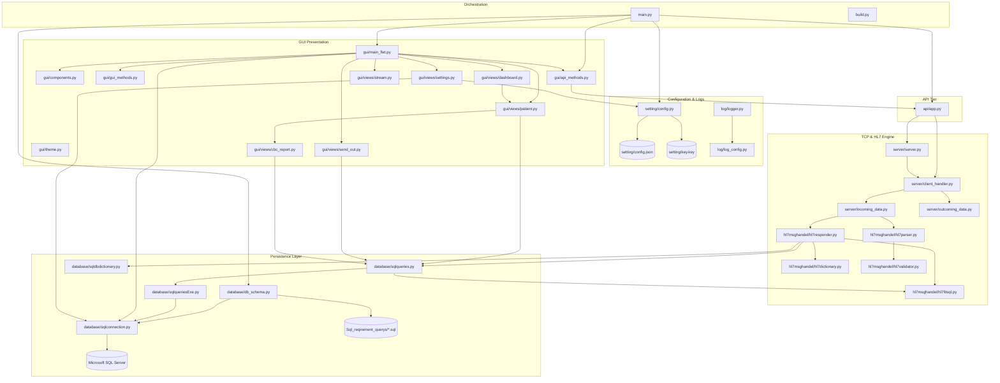
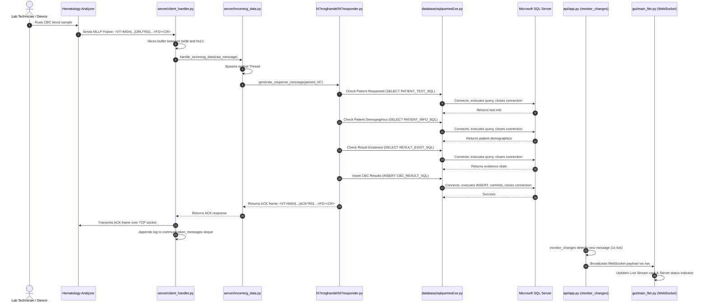

# 01_SYSTEM_MAP: System Topology, Lifecycle, & Architectural Map

**Repository:** `YourLIS` (HealthMesh Laboratory Information System)  
**Auditor:** Lead Software Architect  
**Date:** 2026-11-13  
**Status:** Complete Architectural Map  

---

## 1. High-Level Executive Overview

YourLIS (internally branded as *HealthMesh*) is a hybrid desktop Laboratory Information System (LIS) tailored for clinical laboratory automation, Complete Blood Count (CBC) hematology analyzers, and external reference lab ("Send Out") logistics.

The system combines:
1. **Desktop Presentation Layer**: A graphical interface built on [Flet](https://flet.dev/) (Flutter runtime for Python).
2. **REST & Push Notification Layer**: A local [FastAPI](https://fastapi.tiangolo.com/) service running under Uvicorn with WebSocket broadcasting.
3. **Medical Device Connectivity**: An asynchronous TCP server handling bi-directional MLLP (Minimal Lower Layer Protocol) framed HL7 v2.x messaging (ORU^R01, ORM^O01, ACK^O02) from clinical analyzers (e.g., Genrui KT-60).
4. **Relational Persistence**: Microsoft SQL Server accessed via `pyodbc` executing both dynamic SQL and vendor stored procedures.

```
+-----------------------------------------------------------------------------------------------+
|                                    OPERATING SYSTEM PROCESSES                                 |
+-----------------------------------------------------------------------------------------------+
|                                                                                               |
|  [PARENT PROCESS: main.py]                                                                    |
|    |-- 1. Configuration Check & Fernet Key Setup (`setting/config.py`)                        |
|    |-- 2. Database Schema Check & Migration Execution (`database/db_schema.py`)               |
|    |-- 3. Dynamic Port Allocation & Binding Validation (`main.py:13-22`)                      |
|    |-- 4. Spawns Child Processes via multiprocessing.Process                                   |
|    |                                                                                          |
|    +---> [CHILD PROCESS 1: Flet Desktop GUI (gui/main_flet.py)]                              |
|    |       |-- Flet Native UI Window (Dashboard, Stream, Patient, Send Out, Settings)         |
|    |       |-- WebSocket Client -> ws://127.0.0.1:{API_PORT}/ws (Status/Log Stream)           |
|    |       +-- Service Client (`gui/api_methods.py`) -> http://127.0.0.1:{API_PORT}/api/v1     |
|    |             (Decoupled from direct DB; routes through FastAPI REST with DB fallback)     |
|    |                                                                                          |
|    +---> [CHILD PROCESS 2: FastAPI & TCP Device Server (api/app.py & server/server.py)]       |
|            |-- Uvicorn HTTP Server on 127.0.0.1:{API_PORT}                                    |
|            |-- REST Endpoints (/server/status, /server/messages, /server/start, /server/stop) |
|            |-- Domain REST Endpoints (/api/v1/patients, /api/v1/send-out, /api/v1/cbc)        |
|            |-- WebSocket Server (/ws) with ConnectionManager broadcast loop                   |
|            +-- In-Process Async TCP Socket Server (0.0.0.0 / LAN:{SERVER_PORT})               |
|                  |-- Raw MLLP Frame Handler (\x0b...\x1c\r) with NAK on error & Bounded Buffer |
|                  |-- Spawns worker Thread -> hl7responder -> hl7fitsql                        |
|                  +-- Pooled PyODBC DB Connections (ORU Results Insert/Update)                 |
|                                                                                               |
+-----------------------------------------------------------------------------------------------+
```

---

## 2. Directory Topology & Component Inventory

| Directory | Responsibilities | Key Files | External Dependencies |
| :--- | :--- | :--- | :--- |
| `.` (Root) | Orchestration, packaging, configuration, guides | `main.py`, `build.py`, `pyproject.toml`, `requirements.txt` | `multiprocessing`, `uvicorn`, `flet`, `httpx` |
| `api/` | Internal REST endpoints, WebSocket pub/sub | `app.py` | `fastapi`, `pydantic`, `starlette` |
| `server/` | TCP network transport, MLLP stream slicing, socket lifecycle | `server.py`, `client_handler.py`, `incoming_data.py`, `outcoming_data.py` | `asyncio`, `socket`, `threading` |
| `hl7msghandel/` | HL7 2.x parsing, dictionary mapping, validation, ACK/NAK generation | `hl7parser.py`, `hl7responder.py`, `hl7fitsql.py`, `hl7dictionary.py`, `hl7validator.py` | `hl7` (python-hl7), `copy` |
| `database/` | PyODBC connection factories, dynamic query builders, schema migrator | `sqlconnection.py`, `sqlqueries.py`, `sqlqueriesExe.py`, `db_schema.py`, `sqldbdictionary.py` | `pyodbc` |
| `setting/` | Configuration file I/O, Fernet encryption, password validation | `config.py`, `config.json`, `key.key` | `cryptography.fernet`, `json`, `os` |
| `log/` | Cross-process concurrent rotating file handler, logger wrapper | `logger.py`, `log_config.py` | `concurrent-log-handler`, `logging` |
| `gui/` | Desktop UI framework, themes, shared components, client API bindings | `main_flet.py`, `components.py`, `gui_methods.py`, `api_methods.py`, `theme.py` | `flet`, `httpx`, `websockets` |
| `gui/views/` | Domain pages: Dashboard, Live Stream, Patient Search, Send Out, CBC | `dashboard.py`, `stream.py`, `patient.py`, `send_out.py`, `cbc_report.py`, `settings.py` | `flet`, `datetime` |
| `Sql_reqirement_querys/` | Stored procedures and DDL for "Reallab" database schema | 8 `.sql` scripts in `Reallab/` | Microsoft SQL Server (T-SQL) |
| `tests/` | Unit and integration test suite | 11 test modules covering API, DB, HL7, server, config | `pytest`, `pytest-asyncio`, `pytest-mock` |

---

## 3. Detailed Component Map & Entry Points

### 3.1 Primary Entry Point (`main.py`)
- **Execution Target**: `python main.py` or compiled PyInstaller executable.
- **Initialization Sequence**:
  1. `main.py:276`: Ensures working directories exist (`assets`, `setting`, `logs`).
  2. `main.py:282`: Runs `pre_startup_check()` (`setting/config.py:306`) to ensure `config.json` exists with defaults and validates ODBC driver presence.
  3. `main.py:285-294`: Runs `database_startup_check()` loop. If failed, launches synchronous modal Flet window `show_db_config_window()` (`main.py:87-181`) to prompt user for host/user/pass, updating `config.json` before proceeding.
  4. `main.py:298-324`: Validates IP interface bindings (`validate_binding`) for `API_IP` and `SERVER_HOST`. If unavailable (e.g. host IP changed on DHCP), launches `show_network_config_window()`.
  5. `main.py:327`: Invokes `generate_dynamic_port(api_ip)` to bind to port 0 and retrieve an available ephemeral OS port.
  6. `main.py:329`: Writes `API_PORT` to `config.json` via `save_config`.
  7. `main.py:331-334`: Spawns two child OS processes using Python's `multiprocessing.Process`:
     - `flet_process = multiprocessing.Process(target=run_flet)`
     - `fastapi_process = multiprocessing.Process(target=run_fastapi, args=(api_ip, port))`
  8. `main.py:338-345`: Main thread polls `http://{api_ip}:{port}/server/status` via `httpx.get` until online (timeout 15s), then triggers auto-start of the CBC TCP server via HTTP POST `/server/start`.
  9. `main.py:354`: Blocks on `flet_process.join()`.
  10. `main.py:361-365`: On GUI close, invokes `fastapi_process.terminate()` and `join(timeout=3.0)`.

### 3.2 Backend & API Tier (`api/app.py`)
- **Lifespan**: Runs inside `fastapi_process`.
- **Endpoints**:
  - `GET /server/status`: Inspects in-memory server state (`server.server.is_server_running()`) and client registry (`server.client_handler.clients_with_names`).
  - `GET /server/messages`: Returns the in-memory communication log deque (`server.client_handler.get_communication_messages()`).
  - `POST /server/start`: Asynchronously starts the TCP socket server (`server.server.start_server()`).
  - `POST /server/stop`: Stops the TCP socket server (`server.server.stop_server()`).
  - `WebSocket /ws`: Streams real-time connection status and new communication log frames.
- **Background Task (`api/app.py:92-135`)**:
  - `monitor_changes()` runs an infinite loop `await asyncio.sleep(1)` polling global server and message states, broadcasting JSON payloads to connected WebSockets.

### 3.3 TCP Transport Tier (`server/server.py` & `server/client_handler.py`)
- **Transport**: Raw asynchronous TCP socket server (`asyncio.start_server` on `SERVER_HOST:SERVER_PORT`).
- **Framing Protocol (MLLP)**:
  - Header: `\x0b` (`MESSAGE_START_MARKER`, VT)
  - Trailer: `\x1c` (`MESSAGE_END_MARKER`, FS)
- **Client Session Management**:
  - `client_connected(reader, writer)`: Registers client in `clients[client_address]` and `clients_with_names[client_address]`.
  - Accumulates incoming stream bytes into `bytearray(buffer)` (`client_handler.py:88-98`).
  - Slices completed frames between `\x0b` and `\x1c`.
  - Dispatches frame to `handle_incoming_data(message)`.
  - Writes response ACK/NAK frame via `send_outgoing_data(writer, response)`.

### 3.4 HL7 Business & Persistence Engine (`hl7msghandel/` & `database/`)
- **Parser (`hl7parser.py`)**: Uses `hl7.parse()` to transform raw HL7 pipes-and-hats strings into segment trees.
- **Message Router (`hl7responder.py`)**:
  - `ORU^R01` (Unsolicited Observation Result): Analyzes MSH-9; dispatches to `handel_result_message`.
    - Selects patient request test record (`PATIENT_TEST_SQL`).
    - Selects patient demographics and request date (`PATIENT_INFO_SQL`).
    - Checks if result already exists (`RESULT_EXIST_SQL`).
    - Inserts new row (`data_insert_for(CBC_RESULT_SQL, ...)`) or updates existing row (`data_update_for`).
    - Generates positive `ACK^R01` (`MSA|AA|...`) or negative `ACK` (`MSA|AR|...`).
  - `ORM^O01` (Order Request / Analyzer Query): Extracts patient ID from ORC-3 / PID-3, queries patient info from MSSQL (`PATIENT_INFO_SQL`), and formats `ORR^O02` response with patient demographics.
  - `ACK^O02`: Acknowledges analyzer receipt of patient demographics; requires no response.

### 3.5 Desktop GUI Tier (`gui/`)
- **Runtime**: Flet desktop window running Flutter under Python 3.10+.
- **Views**:
  - `dashboard_view` (`gui/views/dashboard.py`): Aggregate daily metrics (total tests, pending, completed, send-outs), recent patients data table.
  - `stream_view` (`gui/views/stream.py`): Device selector tabs, live HL7 message cards with syntax highlighting, search/filter, and CSV export.
  - `patient_view` (`gui/views/patient.py`): Patient demographic lookup, date-range filtering, paginated data table, and modal trigger to `cbc_report_view`.
  - `send_out_view` (`gui/views/send_out.py`): External lab shipment tracking, sample status updates, fee payment logging.
  - `settings_view` (`gui/views/settings.py`): Application parameters, TCP host/port, database connection parameters and credentials.
  - `cbc_report_view` (`gui/views/cbc_report.py`): Detailed clinical CBC report view, normal range flag calculation, and HTML report exporter.

---

## 4. Architectural Dependency Graph



---

## 5. End-to-End Data Flow

### 5.1 Clinical Sample Processing Flow (Device -> LIS DB -> GUI)



### 5.2 Patient Search & CBC Report Flow (GUI -> DB)

```mermaid
sequenceDiagram
    autonumber
    actor User as Laboratory User
    participant GUI as gui/views/patient.py
    participant Q as database/sqlqueries.py
    participant Exe as database/sqlqueriesExe.py
    participant SQL as Microsoft SQL Server
    participant Report as gui/views/cbc_report.py

    User->>GUI: Enters Patient ID / Date Range & clicks "Search"
    GUI->>Q: exec_procedure_for(PATIENT_SEARCH_SQL, params)
    Q->>Exe: querie_exe(("EXEC GetPatientInfo ...", values))
    Exe->>SQL: Connects via pyodbc, executes stored procedure
    SQL-->>Exe: Returns matching record set
    Exe-->>Q: Returns list of row dicts
    Q-->>GUI: Returns patient records
    GUI->>GUI: In-memory pagination; renders PaginatedDataTable
    
    User->>GUI: Clicks "View Result" on row
    GUI->>Report: cbc_report_view(page, patient_id)
    Report->>Q: exec_procedure_for(PATIENT_CBC_RESULT_SQL, params)
    Q->>Exe: querie_exe(("EXEC GetPatientCBCResult ...", values))
    Exe->>SQL: Connects via pyodbc, executes stored procedure
    SQL-->>Exe: Returns CBC test parameters (WBC, RBC, HGB, PLT...)
    Exe-->>Report: Returns result dict
    Report->>Report: Evaluates age/gender flags via cbc_normal_ranges.py
    Report->>User: Displays clinical modal dialog with flags and ranges
```

---

## 6. External Integrations & System Boundaries

1. **Medical Devices (In Vitro Diagnostics Analyzers)**:
   - Primary Integration: Genrui KT-60 Hematology Analyzer.
   - Physical/Network Layer: Ethernet (TCP/IP).
   - Framing: Health Level Seven (HL7) standard Minimal Lower Layer Protocol (MLLP) on port 4000 (configurable).
   - Message Standard: HL7 Version 2.3.1 / 2.5 (ORU^R01 unsolicited test results, ORM^O01 order inquiries, ACK acknowledgement).
2. **Database Management System**:
   - Platform: Microsoft SQL Server (2012–2022).
   - Protocol: TDS (Tabular Data Stream) via Microsoft ODBC Driver for SQL Server (Driver 17/18 preferred, fallback to SQL Server Native Client).
   - Authentication: SQL Server Authentication (`sa` / password).
3. **Operating System Boundaries**:
   - Platforms Supported: Windows 10/11 x64 (primary target), limited Linux/macOS support.
   - Process Model: Multi-process orchestration via Python standard library `multiprocessing`.
   - Persistence: Local filesystem JSON (`setting/config.json`), Fernet key file (`setting/key.key`), local log files (`logs/HealthMesh_log_*.log`).

---

## 7. State Lifecycle & Data Mutability

| State Domain | Storage Medium | Lifecycle | Concurrency Controls | Mutation Points |
| :--- | :--- | :--- | :--- | :--- |
| **System Configuration** | Disk (`setting/config.json`) | Persistent across application restarts | None (Unprotected file reads/writes) | `main.py:329` (writes `API_PORT`), `gui/views/settings.py:53` (user edits), `main.py:137, 228` (setup modal) |
| **Encryption Secrets** | Disk (`setting/key.key`) | Persistent | None (Plaintext 44-byte base64 file) | `setting/config.py:167, 250` (auto-generated on missing) |
| **Connected Clients** | In-Memory (`server/client_handler.py:clients`) | Process lifespan (wiped on FastAPI restart) | None (Shared mutable dict) | Added at `client_handler.py:86`, removed at `client_handler.py:154` |
| **Client Device Names** | In-Memory (`client_handler.py:clients_with_names`) | Process lifespan | None (Shared mutable dict) | Initialized at `client_handler.py:80`, updated at `client_handler.py:128`, removed at `client_handler.py:155` |
| **Message Buffer** | In-Memory (`client_handler.py:communication_messages`) | FIFO ring buffer (max 100 entries) | Un-synchronized `deque` | Appended at `client_handler.py:53`, shallow-copied at `api/app.py:69, 104` |
| **Server Running State** | In-Memory (`server/server.py:server_running`) | Process lifespan | `threading.Lock` (`status_lock`) | Mutated at `server/server.py:101, 136, 140` |
| **Active WebSockets** | In-Memory (`api/app.py:manager.active_connections`) | Process lifespan | None (Plain Python list) | Appended at `api/app.py:43`, removed at `api/app.py:46` (leaked on dropped connection) |
| **SQL Schema Definitions** | In-Memory (`database/sqldbdictionary.py`) | Module import lifespan | **DESTRUCTIVE IN-PLACE MUTATION** | **`database/sqlqueries.py:42, 95` permanently deletes missing column keys in-place** |
| **GUI Pagination** | In-Memory (`gui/views/patient.py:current_page`) | View module lifespan | Global variable | Mutated at `gui/views/patient.py:273, 298, 305` |
| **GUI Cached Views** | In-Memory (`gui/main_flet.py:cached_views`) | GUI window lifespan | Dictionary | Populated upon first navigation to index (`main_flet.py:158-171`) |

